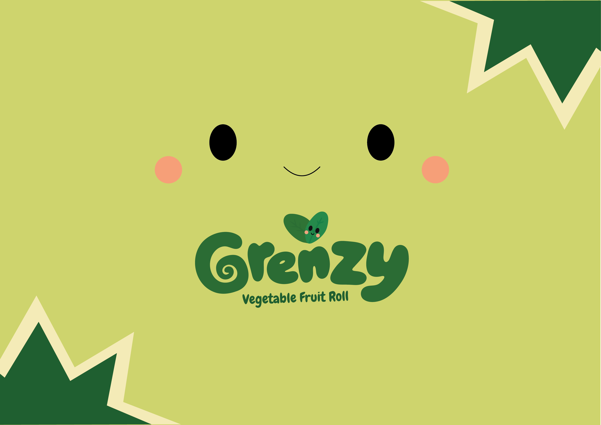
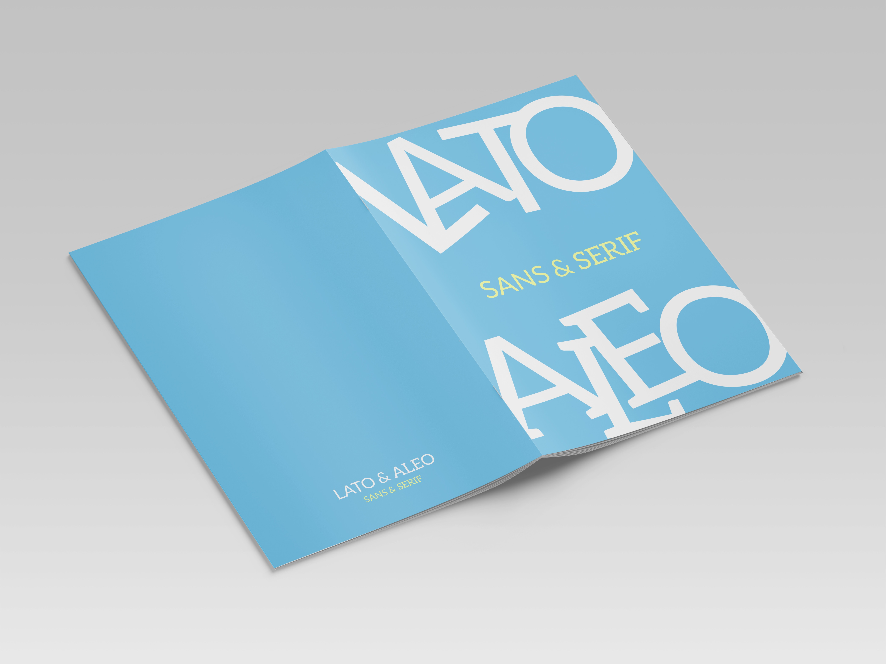
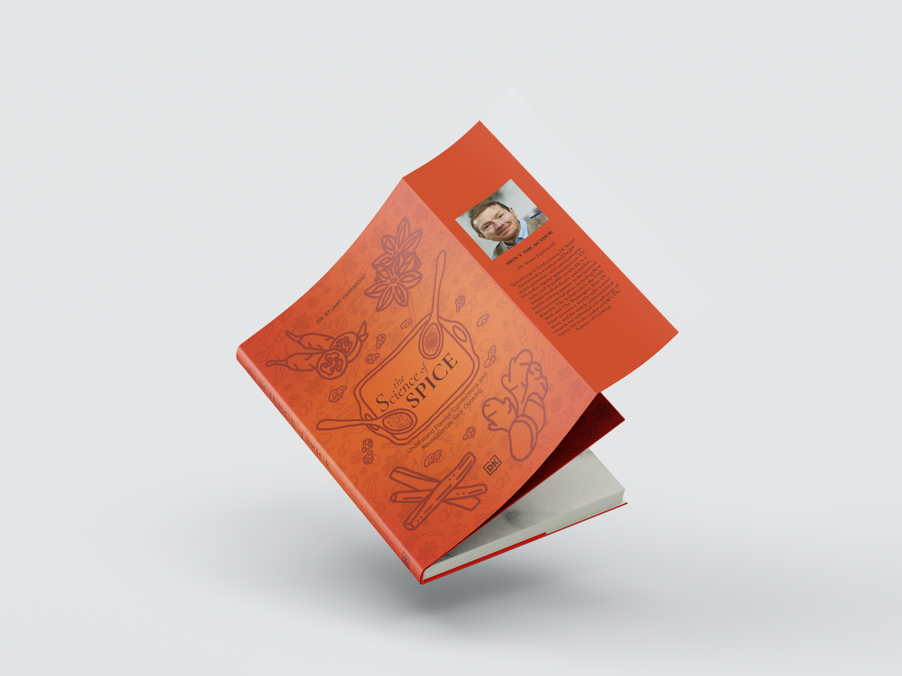

  

  # ✦ Lulu's Studio ✦
  ### *Where Graphic Design Meets Playful Interactive Experiences*

  
  
  

  

    <b>A creative personal portfolio crafted with a playful gaming spirit, modern aesthetics, and interactive charm.</b>
  

  ---

## ✨ Welcome to My Portfolio

Welcome to **Lulu's Studio**! This website is my personal creative space where visual arts, graphic design, and front-end interactivity come together. 

Here, you will find a curated collection of my design works—spanning from typography, editorial layout, and brand identity to packaging and character design. More than just a static showcase, Lulu's Studio invites you to explore, interact, and even play through custom mini-games integrated directly into the experience!

---

## 🎯 About the Project

**Lulu's Studio** was built to bridge the gap between traditional design portfolios and modern interactive web design. The goals of this project are:

- **Express Creative Identity**: Deliver an authentic representation of my visual design style—clean, soft-toned, structured, and inspired by playful pop-culture and gaming aesthetics.
- **Interactive Storytelling**: Provide an engaging journey for visitors through interactive flipbooks, companion animations, and seamless page transitions.
- **Demonstrate Front-End Craftsmanship**: Showcase clean vanilla web development with high performance, zero framework bloat, complete cross-device responsiveness, and accessible dual-theme support.

---

## 🚀 Website Features

| Section | Description |
| :--- | :--- |
| **🏠 Home** | Welcoming hero section featuring Lulu's avatar and interactive Pokémon companions (*Oshawott, Pikachu, Snorlax*) with an interactive speech bubble. |
| **🙋‍♀️ About Me** | An introduction to my background, creative passion, and design philosophy, accompanied by a peeking Pikachu. |
| **🎨 Featured Projects** | Curated project gallery with touch-friendly carousel navigation, expandable cards (*See More / See Less*), and interactive **Heyzine Flipbook modal view** for reading digital publications. |
| **⚡ Skills** | Categorized skill showcase covering *Design & Illustration* (Photoshop, Illustrator, InDesign), *Video & Presentation* (Premiere Pro, Canva), and *UI/UX & Web* (Figma, Antigravity AI). |
| **🎮 Hobbies** | A dedicated creative hub highlighting personal interests and introducing visitors to interactive mini-games. |
| **🎴 Pokémon Card Collection** | **"Let's Play & Collect!"** booster pack simulator with authentic tear-strip animations, foil shimmer effects, 10 collectible cards (ending with *The Trainer*), and rarity tiers (*Common* to *Legendary*). |
| **🧩 Memory Game** | A 10-pair card-matching puzzle game equipped with a live countdown timer, move counter, and automatic personal best score tracker. |
| **🏆 Live Leaderboard** | Real-time score ranking powered by a Google Sheets backend API, displaying top player ranks, completion times, moves, and a highlight badge for your current session. |
| **📬 Let's Connect** | Contact section with direct social links (Instagram, LinkedIn, WhatsApp, Email) and an interactive message form with built-in spam protection (*honeypot*). |

---

## 🛠️ Tools & Technologies

### Web & Front-End
- **HTML5**: Semantic and accessible markup architecture.
- **CSS3 Modern**: CSS Grid, Flexbox, Container Queries, CSS Custom Properties (Variables), and smooth responsive typography with `clamp()`.
- **Vanilla JavaScript (ES6+)**: Fast, lightweight client-side logic for games, modals, carousels, and animations without heavy external frameworks.

### Backend & Cloud Integrations
- **Google Apps Script**: Serverless REST API endpoint handling leaderboard submissions, score validation, and contact inquiries.
- **Google Sheets**: Cloud database for persistent leaderboard records and communication logs.
- **Heyzine Flipbook API**: Embedded digital publication reader for editorial projects.

### Creative Design Suite
- **Adobe Creative Cloud**: Adobe Photoshop, Adobe Illustrator, Adobe InDesign, Adobe Premiere Pro.
- **UI/UX & Prototyping**: Figma, Canva.

---

## 🖼️ Website Preview

| Project Showcase | Editorial & Books |
| :---: | :---: |
|  |  |
| *Brand Identity & Packaging* | *Editorial Layout & Illustration* |

| Typography Studies | Packaging & 3D |
| :---: | :---: |
|  |  |
| *Typography Exploration* | *Packaging Concept* |

---

## 🌐 Visit My Website

Experience the live portfolio directly in your browser:

🔗 **[Launch Lulu's Studio](https://luluaurolavirginia.github.io/website-portfolio/)**

*(If hosted on a custom domain or alternate link, simply update the URL above).*

---

## 💖 Credits & Acknowledgements

- **Visual Assets & Design**: Created by **Lulu Aurola Virginia**.
- **Typography**: Sniglet, Quicksand, and Cabinet Grotesk courtesy of [Google Fonts](https://fonts.google.com).
- **Digital Flipbook Engine**: Powered by [Heyzine](https://heyzine.com).
- **Pokémon Intellectual Property**: Pokémon character illustrations used for personal, non-commercial portfolio inspiration are © Nintendo / Game Freak / Creatures Inc.

---

  Designed & Crafted with 💙 by **Lulu Aurola Virginia** • 2026

